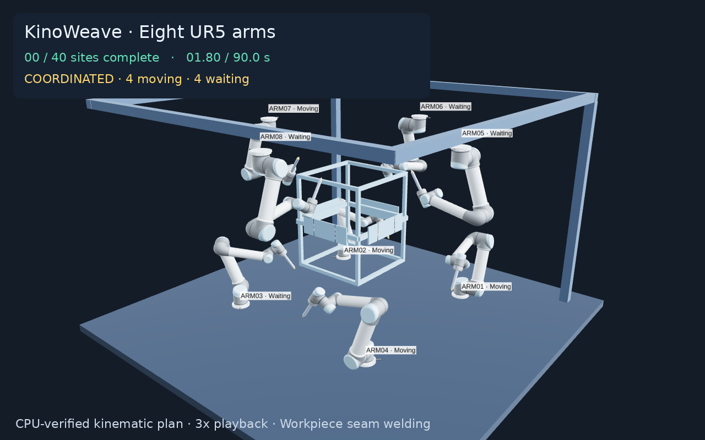

# Eight UR5 arms welding a shared workpiece

Eight six-axis UR5 arms weld forty short beads on a steel fabrication frame.
Four arms stand below the workpiece and four are inverted above it. Twelve
finite steel plates form eight vertical butt seams, shared by neighboring
robots. Every process target is authored on the workpiece, independently of
robot placement or joint configurations.

The pipeline is **workpiece geometry → seam poses → IK → approach/weld/retract
paths → multi-arm timing coordination → independent CPU verification**.
The planner chooses compatible task starts and waits while retaining those
source paths. Starting every arm's next task immediately causes collisions.

[Watch the welding demo](../examples/assets/eight_ur5/demo.mp4) ·
[Overview](../examples/assets/eight_ur5/preview.png) ·
[Weld close-up](../examples/assets/eight_ur5/weld-closeup.png)



The video first shows an explicitly unsafe simultaneous-motion comparison,
then the verified schedule at three times normal speed. A close-up during the
first weld shows the tool approaching, following the plate seam and retracting.
Both executions use the same workpiece, placements, source paths and assignments.
The cell layout is inspired by [cuArms' demonstrations](https://cuarms.github.io/).

## Run the demo

From the source checkout:

```bash
uv run --project environments/viz --frozen python examples/eight_ur5.py --output /tmp/eight-ur5-welding --view
```

Open the printed URL, normally `http://127.0.0.1:8080`. The bundled plan and
portable mesh assets are included. This command freshly checks the saved plan
on CPU without fetching robot data or running IK or planning. No CUDA, Torch,
simulator or source URDF installation is needed for saved playback.

Seek, Play, Loop and Speed control the shared display clock. The Camera menu
includes Overview, Front, Overhead and Workpiece; the mouse can orbit and zoom.
Robot meshes, collision spheres, link skeletons, paths and axes have independent
visibility controls. Changing playback speed leaves the saved motion unchanged.

Arm labels show **Moving**, **Welding**, **Waiting** and **Done**. Waiting means
an arm still has pending work; terminal idle time is excluded. Workpiece points
are colored by arm while pending, yellow during welding and green afterward.
Green beads grow along the actual authored seam. Arc and spark marks are
schematic process indicators and rewind with the shared clock.

## Workpiece targets and torch TCP

The [workpiece definition](../examples/assets/eight_ur5/workpiece.json) contains
plate dimensions, adjoining seam offsets and bead locations in metres. Each
seam belongs to two explicit finite plate collision bodies. The same bodies
are displayed in Viser and checked by planning and validation.

For example, the first bead runs from **(0.34, 0.11, 0.679)** to
**(0.34, 0.11, 0.687)** metres, on the shared outer face of two plates, with
outward surface normal **(+1, 0, 0)**. Its position is not derived from FK.
Moving a robot base leaves these workpiece targets unchanged; IK must solve
their new reachability.

The virtual **weld TCP** lies on that surface and points into it, opposite the
outward normal. The visible nozzle stops **12 mm before the TCP**, with an arc
indicator bridging the gap during welding. The rigid torch body and its
collision spheres stay clear of the steel. Workpiece contact is not exempted
from collision checking.

IK generates approach, bead and retract poses. Each 8 mm bead uses four
Cartesian waypoint segments with stopped-quintic joint interpolation. The
example separately checks every welding interval at 0.025 s, including all
waypoints and endpoints: position along the bead, both adjoining finite plate
faces, tool orientation and nozzle gap. The numerical path tolerance is
50 µm and the orientation tolerance is 0.0001 rad. These are demonstration
checks on the kinematic model, not physical welding accuracy specifications.

Each arm has five 15-second home-to-home tasks, including one second of bead
motion. The uncoordinated 75-second candidate fails collision verification.
The bundled coordinated execution lasts 90 seconds. The baseline conflict
graph connects all eight arms, with interference partners changing between
joints. Only per-arm precedence is authored; cross-arm starts and waits are
chosen from geometric compatibility.

## Compare coordinated and uncoordinated execution

Use **Execution → Uncoordinated (unsafe)** to start each arm's identical source
motions as soon as its preceding task finishes. **Show baseline collision**
jumps to a recorded witness. Red markers identify colliding robot pairs and
their native sphere clearances. Switch back to **Coordinated** for the verified
schedule.

The comparison is deliberately invalid and labeled as such. The viewer's
stored successful result remains the verified schedule; the core viewer still
rejects invalid trajectories. After the counterfactual finishes, its arms hold
home for the remainder of the shared display clock.

A saved run includes `coordination.json`: input/plan identities, failed baseline
validation, geometric witnesses, interfering pairs and planner-induced delays.
`uncoordinated.candidate.json` keeps that invalid candidate separate from the
successful `result.json`. The `welding` section of `planning.json` reports
surface/seam tracking errors and the nozzle gap.

## Replay a saved run

```bash
uv run --project environments/viz --frozen python examples/eight_ur5.py --replay /tmp/eight-ur5-welding --view
```

Keep the complete run directory together: input, result, demo metadata,
manifest, assets and notices. Meshes are bound to the exact native model/link
frames by hashes. The workpiece definition is embedded in demo metadata, so
saved runs are self-contained. GPU-generated runs can be viewed on a CPU-only
machine. The viewer recomputes the welding and comparison checks.

Earlier inspection demos with floating FK-derived targets use different
metadata and are not accepted as this welding scene; generate a new output
directory with the command above.

## Generate a new plan

The default uses the saved demonstration plan. Regeneration needs the pinned
URDF assets and optional URDF environment, including NumPy for example IK:

```bash
uv run --project environments/viz --frozen python examples/fetch_ur5.py
uv run --project environments/viz --frozen python examples/eight_ur5.py --plan --seconds 2400 --output /tmp/eight-ur5-welding-new
```

For GPU planning, use the [qualified CUDA environment](curobo.md):

```bash
uv run --project environments/cuda12 --frozen python examples/fetch_ur5.py
uv run --project environments/cuda12 --frozen python examples/eight_ur5.py --plan --backend curobo --output /tmp/eight-ur5-welding-gpu
uv run --project environments/viz --frozen python examples/eight_ur5.py --replay /tmp/eight-ur5-welding-gpu --view
```

The multi-arm planner checks complete robot/robot and static-world geometry,
then independently verifies the result on CPU. The example requires both
successful workpiece tracking and a genuinely colliding uncoordinated baseline.
`--seconds` sets the planning budget; dense full-arm regeneration can take
substantial time. GPU requests never silently fall back to CPU planning.

## Export a video

The exporter uses Playwright's Chromium or system Chrome and FFmpeg. Install a
browser with `uv run --project environments/viz --frozen playwright install chromium`
if none is available; FFmpeg is installed separately.

```bash
uv run --project environments/viz --frozen python examples/eight_ur5.py --replay /tmp/eight-ur5-welding --video /tmp/eight-ur5-welding.mp4 --video-speed 3
```

It writes an MP4, overview PNG, close-up PNG and video-settings sidecar. Use
`--video-planned-only` to omit the unsafe comparison, or `--video-fps` to change
the frame rate. Native WebGL is attempted with a logged software fallback;
`--video-renderer software` explicitly selects software rendering. This affects
image rendering independently of the planning backend.

## Geometry and scope

The robot meshes derive from the pinned UR5 asset with its
[original attribution](../examples/assets/ur5/NOTICE.md). Original robot
collision spheres are retained, with six explicit rigid-torch spheres and an
authored tapered nozzle. Source meshes and original notices accompany the
portable bundle. The torch dimensions and nominal gap are demonstration inputs.

This is a kinematic welding-path showcase with configured assignments and
IK-generated source paths; multi-arm coordination searches task starts and
waits. Collision validation is sampled. Arc/spark indicators do not simulate
heat, molten metal, deposition, weld quality or process control. Botrail,
MuJoCo and Isaac Sim remain optional execution integrations.
